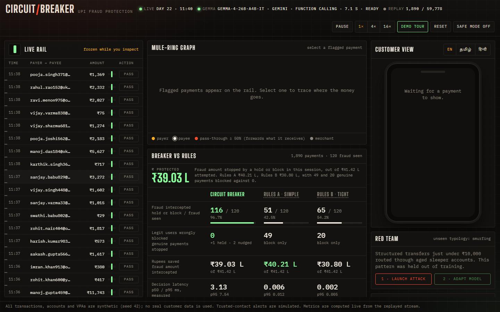
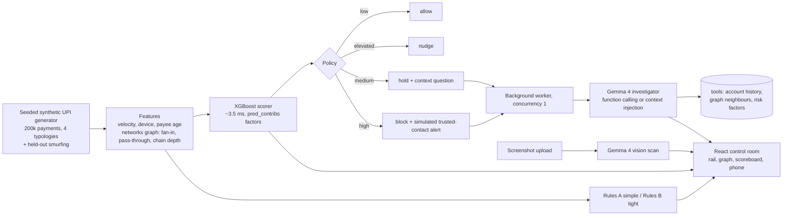

# Circuit Breaker

Real-time UPI fraud protection that trips like a breaker, not like a wall. A live stream of rupee payments passes through a fast XGBoost risk scorer; risky ones go to an open-weight **Gemma 4** investigator that checks the evidence with tools, explains the risk, and picks a proportional response: allow, nudge, hold with a question, or block.

> **All data is synthetic.** Accounts, VPAs and payments are generated from a fixed seed. No real customer data is used. The trusted-contact alert is simulated.



## The problem

Fraud in UPI keeps changing shape: social-engineering calls, mule rings, card/UPI testing, account takeover, and structuring through sleeper accounts. Rule-based systems block too many genuine payments, miss new patterns, and cannot explain themselves to the customer in their own language. Sending payment data to a closed model is a privacy problem.

Circuit Breaker aims for fewer false blocks, adaptability to new fraud, explanations a customer can read in English, Tamil or Hindi, and privacy through a model that can run fully on the bank's own hardware.

## Architecture



- **backend/** FastAPI app. `generator.py` builds the data, `scorer.py` trains and serves XGBoost, `rules.py` holds both baselines, `policy.py` maps risk to action and holds the customer copy, `investigator.py` is the Gemma provider chain, `engine.py` replays the stream and keeps the metrics.
- **web/** Vite + React + TypeScript, framer-motion, canvas force graph. Fonts are bundled offline.

## How Gemma 4 is used

1. **Investigator.** Every hold or block goes to a single background worker, so the stream never waits. Gemma gets the payment and runs in one of two modes, shown on every explanation:
   - **function calling**: Gemma calls `get_account_history`, `get_graph_neighbours` and `get_risk_factors` itself.
   - **context injection**: if a call with tools fails, the backend runs the same three lookups and puts the results in the prompt. After two consecutive tool failures that are not transient server errors (5xx or 429), the provider stays in this mode. The reason is recorded on the result.
   Output is strict JSON (`verdict`, `reason`, `customer_message`, `analyst_note`) and is validated.
2. **Multilingual customer messages.** The customer message is requested in English, Tamil or Hindi. For Tamil and Hindi the reply must contain characters in that script, or the hand-written template is shown and labelled as a template.
3. **Screenshot scan (vision).** `POST /api/scan-screenshot` sends an image of a payment request or scam SMS to Gemma 4. It returns the payee, amount, urgency, pressure cues, scam signals and a risk contribution.

Every model-written explanation carries a provenance label such as `Gemma 4 E4B · local · function calling`, `Gemma 4 26B · Gemini API · context injection`, or `Template (model unavailable)`. Template text is never presented as model output.

### Providers

`LLM_PROVIDER=auto` (the default) tries, in order:

| # | Provider | When it is used | Model |
|---|---|---|---|
| 1 | `ollama` | `OLLAMA_URL` reachable and the model is pulled | `gemma4:e4b` (open weights, runs locally) |
| 2 | `gemini` | `GEMINI_API_KEY` set | `gemma-4-26b-a4b-it` via the google-genai SDK |
| 3 | `openai_compat` | `LLM_BASE_URL` set | `LLM_MODEL` on any OpenAI-compatible server (vLLM, llama.cpp, LM Studio…) |
| 4 | template | nothing reachable | deterministic, labelled |

On the Gemini API, Gemma 4 thinks at length by default (about 27 s per call in our tests), so requests use `thinking_level="minimal"`, which brings a call to about 4 s. Timeouts: 60 s for local Ollama on CPU, 10 s for API providers. On a timeout or error, the labelled template is used. A tiny warm-up request runs at startup. The header badge shows the provider, model, mode, last latency and state. After warm-up, the first 8 flagged payments of the seeded stream are investigated in the background. The results are cached in `data/` (gitignored) per transaction and provider, so real model output is ready before a demo.

### Verified run

Run with `scripts/verify_provider.py` and `scripts/demo_check.py` on the Gemini API (`gemma-4-26b-a4b-it`):

| Check | Provider · mode | Latency | Result |
|---|---|---|---|
| Investigation, English | Gemini API · function calling (all 3 tools) | 6.3–8.2 s | verdict, reason, analyst note, English message |
| Investigation, Tamil | Gemini API · function calling (all 3 tools) | 8.4 s | customer message in Tamil script |
| Screenshot scan (`docs/sample-scam-sms.png`) | Gemini API · vision | 6.5–12.6 s | payee `billdesk.helpdesk@okaxis`, ₹4,999, urgency high, impersonation and disconnection-threat signals |

Local Ollama (`gemma4:e4b`) is implemented, but it was not installed on the test machine, so it has not been verified here.

### Demo safe mode

The **Safe mode** button in the header replays real model outputs cached on disk and never waits on a model. Replayed results keep their original label, with `· replayed from cache` added. A payment with no cached output gets the labelled template.

## Run it (Windows, PowerShell)

Requirements: Python 3.10+, Node 18+.

```powershell
python -m venv .venv
.\.venv\Scripts\python -m pip install -r requirements.txt
cd web; npm install; npm run build; cd ..
copy .env.example .env   # then edit; every variable is optional
.\.venv\Scripts\python -m uvicorn backend.api:app --port 8000
```

Open http://127.0.0.1:8000. The first start generates the data and trains the model in about 10 s; both are cached afterwards.

Or do all of the above in one command (it creates the venv and builds the UI if needed, with clear errors):

```powershell
powershell -ExecutionPolicy Bypass -File scripts\run_demo.ps1          # add -Check to run scripts\demo_check.py once it is up
```

`scripts\demo_check.py` exercises every endpoint of a running server, including a real investigation and scan when a provider is ready, and exits non-zero on any failure.

**Local Gemma 4 with Ollama** (keep model files off a full drive by setting `OLLAMA_MODELS` first):

```powershell
$env:OLLAMA_MODELS = "D:\ollama\models"
ollama pull gemma4:e4b
# in .env: LLM_PROVIDER=ollama   (or leave auto)
```

**Gemini API:** set `GEMINI_API_KEY` in `.env`, and optionally `LLM_PROVIDER=gemini`.

**Any OpenAI-compatible API:** set `LLM_BASE_URL` (e.g. `http://localhost:8080/v1`), `LLM_MODEL` and, if needed, `LLM_API_KEY`.

For frontend development: run `npm run dev` in `web/` (port 5173, proxies `/api` and `/ws` to port 8000).

## Tests

```powershell
.\.venv\Scripts\python -m pytest -q tests
```

These cover generator determinism and typologies, red-team reproducibility, scorer AUC on held-out days, attribution consistency, latency, the red-team miss and adapt, policy mapping, both rule engines, copy completeness in all three languages, and the investigator's fallback, mode switch, script check, timeout and provenance labels (using a fake provider).

## Results (seed 42, held-out days 22–30, 59,778 payments, 1,324 fraud)

| | Circuit Breaker | Rules A (simple) | Rules B (tight) |
|---|---|---|---|
| Fraud intercepted (hold or block) | **1,246 (94.1%)** | 761 (57.5%) | 753 (56.9%) |
| Genuine payments blocked | **9** | 1,677 | 571 |
| Fraud amount intercepted | ₹630 L of ₹677 L | ₹655 L | ₹549 L |
| Decision latency p50 (CPU) | ~3.5 ms | <0.02 ms | <0.02 ms |

Circuit Breaker also held 17 genuine payments with a question and nudged 40. Rules A intercepts slightly more rupees because it blocks every payment above ₹50,000, at the cost of 1,677 genuine customers. The scorer's AUC on typologies 1–4 over these days is 0.9998. That is high because the data is synthetic and its typologies are cleanly separable; real data will be harder.

**Red team.** The run is seeded, so the same sequence of attack and adapt gives the same numbers every time. Smurfing (structured sub-₹10,000 transfers through aged sleeper accounts) never appears in training. On 925 payments from held-out smurfing campaigns, Circuit Breaker intercepts 20.7%, and both rule sets 0%. **Adapt** retrains on the labelled half of the attack campaigns in about 1.7 s. Detection on the *other* campaigns then rises to 99.9%, with AUC on typologies 1–4 unchanged at 0.9998.

Rules A: amount > ₹50,000; first-time payee and > ₹25,000; > 10 payments in an hour.
Rules B: first-time payee, > ₹10,000, 22:00–04:59; new device and > ₹10,000; > 6 payments in an hour; > ₹1,50,000.

## API

| Method | Path | Purpose |
|---|---|---|
| GET | `/api/health` | provider status, thresholds, rule texts |
| GET | `/api/metrics` | live scoreboard numbers |
| WS | `/ws` | stream batches, investigation results, status |
| POST | `/api/stream/control` | pause / resume / reset / speed |
| POST | `/api/investigate/{id}?lang=` | queue an investigation (returns done or pending) |
| GET | `/api/graph/{id}` | payee neighbourhood for the mule-ring graph |
| POST | `/api/scan-screenshot` | Gemma 4 vision scan of an image |
| POST | `/api/redteam/attack` | inject a smurfing burst |
| POST | `/api/redteam/adapt` | retrain and report before/after |
| POST | `/api/safe-mode` | replay cached model outputs only |
| GET | `/api/llm-status` | provider, model, mode, last latency, state |

## Limitations

- **Synthetic data.** The typologies are modelled, not learned from real fraud, so the separation is cleaner than in practice. Graph features come from a snapshot of the whole period rather than strictly point-in-time.
- **Simulated alerts.** The trusted-contact alert is simulated; nothing is sent.
- **Small-scale retraining.** The adapt step retrains on a 40k-row subsample plus labelled attack data in about 2 s. A real system needs review, validation and a staged rollout.
- **Model latency.** A full investigation with three tool calls takes 6–8 s on the Gemini API, and is expected to take tens of seconds for `gemma4:e4b` on a laptop CPU (untested here). That is why investigations run in a single background worker, never block the stream, and can be pre-computed and replayed in safe mode.
- **Scoring latency in the live server** is about 3–7 ms p50, and p95 has measured close to 10 ms while the server is also streaming and serving WebSockets.
- **Translations.** The Tamil and Hindi templates were written carefully but need a native-speaker review (see `docs/translations.md`).

## License

MIT. See [LICENSE](LICENSE).
