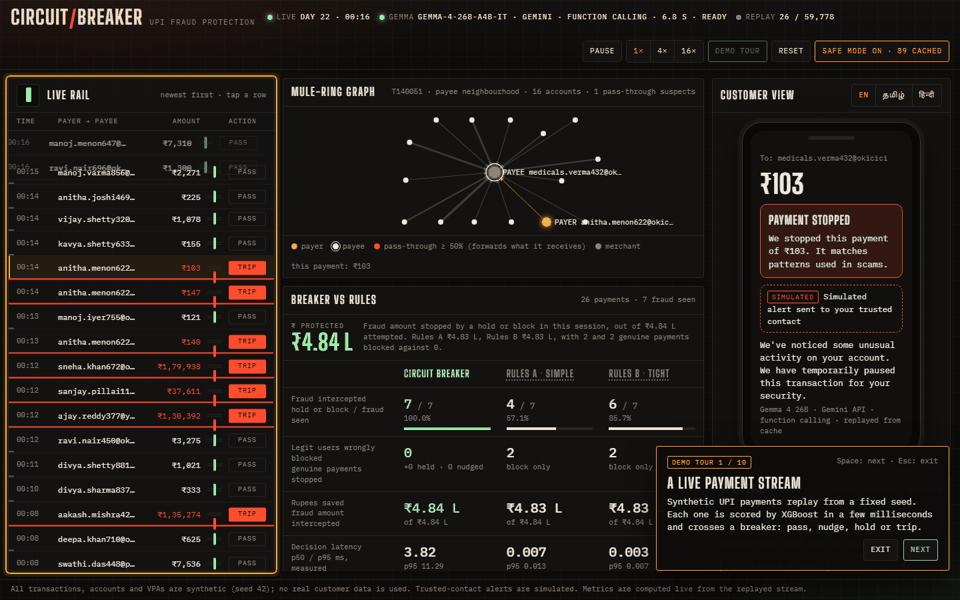
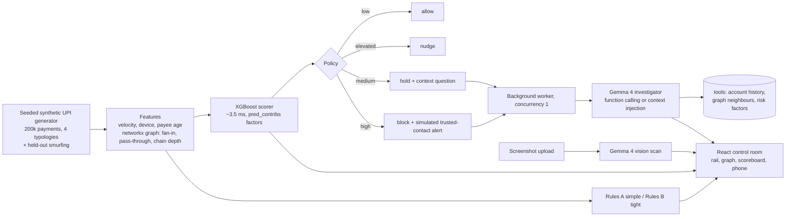

# Circuit Breaker

Real-time UPI fraud protection that trips like a breaker, not like a wall. A stream of rupee payments passes through an XGBoost risk scorer. Risky payments go to an open-weight **Gemma 4** investigator, which checks the evidence with tools, explains the risk, and picks a proportional response: allow, nudge, hold with a question, or block.

> **All data is synthetic.** Accounts, VPAs and payments are generated from a fixed seed. No real customer data is used. The trusted-contact alert is simulated.



## Results

Seed 42, held-out days 22–30: 59,778 payments, 1,324 of them fraud.

| | Circuit Breaker | Rules A (simple) | Rules B (tight) |
|---|---|---|---|
| Fraud intercepted (hold or block) | **1,246 (94.1%)** | 761 (57.5%) | 753 (56.9%) |
| Genuine payments blocked | **9** | 1,677 | 571 |
| Fraud amount intercepted | ₹630 L of ₹677 L | ₹655 L | ₹549 L |
| Decision latency p50 (CPU) | ~3.5 ms | <0.02 ms | <0.02 ms |

Circuit Breaker also held 17 genuine payments with a question and nudged 40. Rules A intercepts slightly more rupees because it blocks every payment above ₹50,000, at the cost of 1,677 genuine customers. The scorer's AUC on typologies 1–4 over these days is 0.9998. That is high because the data is synthetic and its typologies are cleanly separable; real data will be harder.

**Red team.** The run is seeded, so the same sequence of attack and adapt gives the same numbers every time. Smurfing (structured sub-₹10,000 transfers through aged sleeper accounts) never appears in training. On 925 payments from held-out smurfing campaigns, Circuit Breaker intercepts 20.7%, and both rule sets 0%. **Adapt** retrains on the labelled half of the attack campaigns in about 1.7 s. Detection on the *other* campaigns then rises to 99.9%, with AUC on typologies 1–4 unchanged at 0.9998.

The rule sets:
- **Rules A:** amount > ₹50,000; first-time payee and > ₹25,000; > 10 payments in an hour.
- **Rules B:** first-time payee, > ₹10,000, 22:00–04:59; new device and > ₹10,000; > 6 payments in an hour; > ₹1,50,000.

## Architecture



- **backend/** FastAPI app.
  - `generator.py` builds the data.
  - `scorer.py` trains and serves XGBoost.
  - `rules.py` holds both baselines.
  - `policy.py` maps risk to action and holds the customer copy.
  - `investigator.py` is the Gemma provider chain.
  - `engine.py` replays the stream and keeps the metrics.
- **web/** Vite + React + TypeScript, framer-motion and a canvas force graph. Fonts are bundled, so nothing is loaded from a CDN.

## Try it in 2 minutes

Once Python and Node dependencies are installed (see [Run it](#run-it)):

1. Start the server: `python -m backend` (on Windows, `.\.venv\Scripts\python -m backend`). The first start generates the data and trains the model in about 10 s.
2. Open http://127.0.0.1:8000.
3. Click **Demo tour** and press Space to step through it. Esc exits. It shows:
   - the stream
   - a tripped payment and its risk factors
   - the mule-ring graph
   - the Gemma explanation, in English, Tamil and Hindi
   - a red-team attack and the adapt step
   - a screenshot scan
4. With no model provider, or if the network is unreliable, turn on **Safe mode** first. The tour then replays real Gemma output cached on disk, labelled "replayed from cache". It needs no network.

Screenshots: [desktop](docs/screens/desktop.png), [1366×768](docs/screens/desktop-1366x768.png), [1920×1080](docs/screens/desktop-1920x1080.png), [phone](docs/screens/mobile-phone.png), and [each tour step](docs/tour/).

## How Gemma 4 is used

1. **Investigator.** Every hold or block goes to a single background worker, so the stream never waits. Gemma gets the payment and runs in one of two modes, and every explanation shows which one ran:
   - **function calling:** Gemma calls `get_account_history`, `get_graph_neighbours` and `get_risk_factors` itself.
   - **context injection:** if a call with tools fails, the backend runs the same three lookups and puts the results in the prompt. After two failures in a row that are not temporary server errors (5xx or 429), the provider stays in this mode. The reason is recorded on the result.

   Output is strict JSON (`verdict`, `reason`, `customer_message`, `analyst_note`), and it is validated.
2. **Multilingual customer messages.** The customer message is requested in English, Tamil or Hindi. For Tamil and Hindi, the reply must contain characters in that script. Otherwise the hand-written template is shown and labelled as a template.
3. **Screenshot scan (vision).** `POST /api/scan-screenshot` sends an image of a payment request or scam SMS to Gemma 4. It returns the payee, amount, urgency, pressure cues, scam signals and a risk contribution.

Every model-written explanation carries a provenance label, such as `Gemma 4 E4B · local · function calling`, `Gemma 4 26B · Gemini API · context injection`, or `Template (model unavailable)`. Template text is never presented as model output.

### Providers

`LLM_PROVIDER=auto` (the default) tries, in order:

| # | Provider | When it is used | Model |
|---|---|---|---|
| 1 | `ollama` | `OLLAMA_URL` reachable and the model is pulled | `gemma4:e4b` (open weights, runs locally) |
| 2 | `gemini` | `GEMINI_API_KEY` set | `gemma-4-26b-a4b-it` via the google-genai SDK |
| 3 | `openai_compat` | `LLM_BASE_URL` set | `LLM_MODEL` on any OpenAI-compatible server (vLLM, llama.cpp, LM Studio…) |
| 4 | template | nothing reachable | deterministic, labelled |

- **Speed.** On the Gemini API, Gemma 4 thinks at length by default (about 27 s per call in our tests). Requests therefore use `thinking_level="minimal"`, which brings a call to about 4 s.
- **Timeouts.** 60 s for local Ollama on CPU and 10 s for API providers. On a timeout or error, the labelled template is used.
- **Status badge.** A small warm-up request runs at startup and retries temporary errors. The header badge then shows the provider, model, mode, last latency and state: ready, slow, busy or offline, with a short reason.
- **Pre-warm.** After warm-up, the first 8 flagged payments of the seeded stream are investigated in English, Tamil and Hindi, and the sample scam screenshot is scanned in all three. Results are cached in `data/` (gitignored) per payment or image, language and provider.

### Verified run

These were run with `scripts/verify_provider.py` and `scripts/demo_check.py` on the Gemini API (`gemma-4-26b-a4b-it`):

| Check | Provider · mode | Latency | Result |
|---|---|---|---|
| Investigation, English | Gemini API · function calling (all 3 tools) | 6.3–8.2 s | verdict, reason, analyst note, English message |
| Investigation, Tamil | Gemini API · function calling (all 3 tools) | 8.4 s | customer message in Tamil script |
| Screenshot scan (`docs/sample-scam-sms.png`) | Gemini API · vision | 5.6–12.6 s | payee `billdesk.helpdesk@okaxis`, ₹4,999, urgency high, impersonation and disconnection-threat signals |

Local Ollama (`gemma4:e4b`) is implemented, but it was not installed on the test machine, so it has not been verified here.

### Safe mode

The **Safe mode** button in the header replays real model outputs cached on disk, and it never waits on a model. Replayed results keep their original label, with `· replayed from cache` added. A payment with no cached output gets the labelled template.

## Run it

Requirements: Python 3.10+ and Node 18+. The server binds to `127.0.0.1` unless `HOST` is set.

### Windows (PowerShell)

```powershell
python -m venv .venv
.\.venv\Scripts\python -m pip install -r requirements.txt
cd web; npm install; npm run build; cd ..
copy .env.example .env   # then edit; every variable is optional
.\.venv\Scripts\python -m backend
```

Or do all of this in one command. It creates the venv and builds the UI if needed, and stops with a plain error message if something is missing:

```powershell
powershell -ExecutionPolicy Bypass -File scripts\run_demo.ps1          # add -Check to run scripts\demo_check.py once it is up
```

### macOS and Linux (bash)

```bash
python3 -m venv .venv
.venv/bin/python -m pip install -r requirements.txt
(cd web && npm install && npm run build)
cp .env.example .env   # then edit; every variable is optional
.venv/bin/python -m backend
```

### Docker

```bash
docker build -t circuit-breaker .
docker run --rm -p 127.0.0.1:8000:8000 --env-file .env circuit-breaker
```

Inside the container the server listens on `0.0.0.0`. The `-p 127.0.0.1:8000:8000` mapping keeps it reachable from this machine only. Without `--env-file`, investigations use labelled templates. To use a local Ollama from the container, set `OLLAMA_URL=http://host.docker.internal:11434`. CI builds the image and checks `/api/health` on every push.

### Model providers

**Local Gemma 4 with Ollama.** If you want model files kept off a full drive, set `OLLAMA_MODELS` before pulling and before starting the Ollama server. `D:\ollama\models` and `~/ollama-models` below are only example paths; use any folder with enough free space for the model.

```powershell
$env:OLLAMA_MODELS = "D:\ollama\models"   # example path
ollama pull gemma4:e4b
# in .env: LLM_PROVIDER=ollama   (or leave auto)
```

```bash
export OLLAMA_MODELS="$HOME/ollama-models"   # example path
ollama pull gemma4:e4b
# in .env: LLM_PROVIDER=ollama   (or leave auto)
```

**Gemini API:** set `GEMINI_API_KEY` in `.env`, and optionally `LLM_PROVIDER=gemini`.

**Any OpenAI-compatible API:** set `LLM_BASE_URL` (e.g. `http://localhost:8080/v1`), `LLM_MODEL` and, if needed, `LLM_API_KEY`.

For frontend development, run `npm run dev` in `web/`. It uses port 5173 and proxies `/api` and `/ws` to port 8000.

## Tests and checks

```bash
python -m pytest -q tests          # use .venv/bin/python or .\.venv\Scripts\python
python scripts/demo_check.py       # every endpoint, against a running server
python scripts/failure_drills.py   # invalid key, no internet, slow model, closed WebSocket
python scripts/tour_check.py       # the demo tour, headless, in Safe mode with outside network blocked
```

**pytest covers:**
- the static-file route (path traversal never reaches `.env`), the upload size limit and the default bind address
- generator determinism and typologies, and red-team reproducibility
- scorer AUC on held-out days, attribution consistency and latency
- the red-team miss and adapt
- policy mapping and both rule engines
- copy completeness in all three languages
- the investigator, using a fake provider: fallback, mode switch, script check, timeout, warm-up retry, error classification and provenance labels

**Failure drills.** Each one runs a separate server with a broken provider and checks the API and the page. In each case, the header shows a short status ("model provider rejected the API key", "unreachable (network)", "did not answer within 10 s", "connection lost · retrying"). Investigations fall back to the labelled template, and no raw exception text reaches the page. Screenshots are in [docs/drills](docs/drills/).

CI (`.github/workflows/ci.yml`) runs pytest, the frontend lint and build, and the Docker build.

## API

| Method | Path | Purpose |
|---|---|---|
| GET | `/api/health` | provider status, thresholds, rule texts, pre-warm progress |
| GET | `/api/metrics` | live scoreboard numbers |
| WS | `/ws` | stream batches, investigation results, status |
| POST | `/api/stream/control` | pause / resume / reset / speed |
| POST | `/api/investigate/{id}?lang=` | queue an investigation (returns done or pending) |
| GET | `/api/graph/{id}` | payee neighbourhood for the mule-ring graph |
| POST | `/api/scan-screenshot` | Gemma 4 vision scan of an image (max 6 MB) |
| GET | `/api/sample-scam-sms` | the fictional sample screenshot |
| POST | `/api/redteam/attack` | inject a smurfing burst |
| POST | `/api/redteam/adapt` | retrain and report before/after |
| POST | `/api/safe-mode` | replay cached model outputs only |
| GET | `/api/llm-status` | provider, model, mode, last latency, state |

## Limitations

- **Synthetic data.** The typologies are modelled, not learned from real fraud, so the separation is cleaner than in practice. Graph features come from a snapshot of the whole period rather than strictly point-in-time.
- **Simulated alerts.** The trusted-contact alert is simulated; nothing is sent.
- **Small-scale retraining.** The adapt step retrains on a 40k-row subsample plus labelled attack data in about 2 s. A real system needs review, validation and a staged rollout.
- **Model latency and quota.** A full investigation with three tool calls takes 6–8 s on the Gemini API. On a laptop CPU, `gemma4:e4b` is expected to take tens of seconds (untested here). The free Gemini tier also returned rate-limit errors (429) during pre-warm. This is why investigations run in a single background worker, never block the stream, and can be pre-computed and replayed in Safe mode.
- **Scoring latency in the live server** is about 3–7 ms p50. p95 has measured close to 10 ms while the server is also streaming and serving WebSockets.
- **Translations.** The Tamil and Hindi templates were written carefully but need a native-speaker review (see `docs/translations.md`).

See [MODEL_CARD.md](MODEL_CARD.md) for intended use and the trade-off between blocking fraud and blocking genuine payments. See [CONTRIBUTING.md](CONTRIBUTING.md) to get involved.

## License

MIT. See [LICENSE](LICENSE).
